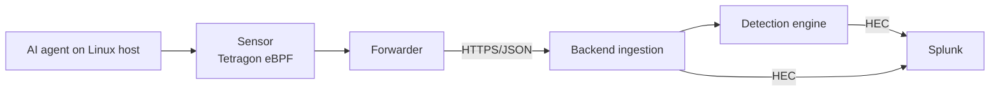

# Architecture

| Component | Responsibility |
|---|---|
| Sensor | Captures process, file, and network events from the kernel. auditd is the fallback. |
| Forwarder | Keeps events from the agent's process tree, normalizes them to the event schema, redacts secrets, sends batches. |
| Backend ingestion | Validates events against the schema; rejects malformed events with a reason. |
| Detection engine | Evaluates events against YAML rules; emits detection records referencing their events. |
| Splunk | Stores activity and detections in separate sourcetypes for search and investigation. |

AgentWatch observes and reports only. It never blocks or remediates.
